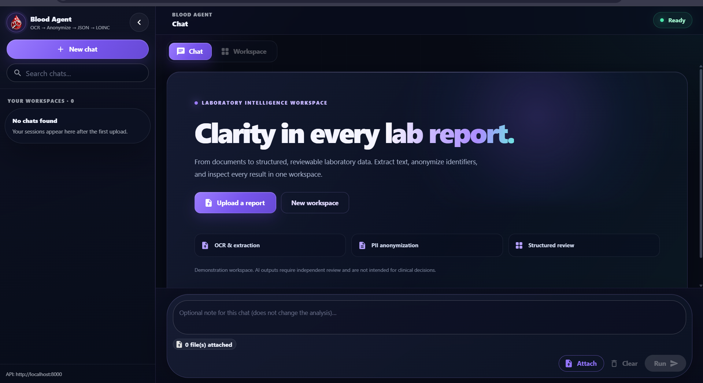
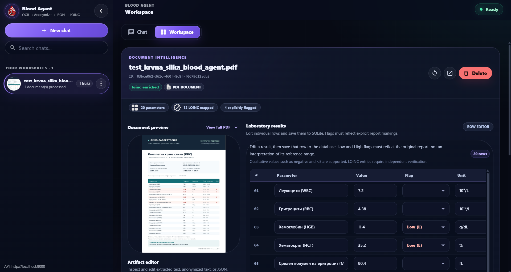

# Blood Agent

**AI-assisted laboratory report processing with OCR, local-first anonymization, structured JSON extraction, and conservative LOINC mapping.**

Blood Agent is an end-to-end academic and portfolio project for processing laboratory reports supplied as PDF or image files. It combines text extraction, PII anonymization, AI-assisted structuring, object storage, a FastAPI API, and a React review workspace.

> **Research and demonstration only.** Blood Agent is not a medical device or a clinical decision-support system. Do not use its output for diagnosis, treatment, or other clinical decisions. The current implementation has no user authentication or per-user access control and must not be exposed publicly with real patient data.

## Overview

```text
PDF / image upload
        |
        v
Text extraction / OCR (local by default)
        |
        v
PII anonymization (local by default)
        |
        v
Structured laboratory JSON (configured AI model)
        |
        v
Conservative LOINC mapping (deterministic)
        |
        v
Review and editing in the web application
```

A PydanticAI agent coordinates the stages using ordered tools. The API also supports reading and editing stored artifacts and saving individual laboratory rows.

## Features

- Upload and process multiple PDF or image reports in one request.
- Extract embedded PDF text; use Tesseract and OCRmyPDF for scanned documents.
- Use Macedonian and English OCR (`mkd+eng`) by default.
- Anonymize extracted text with local rules and Microsoft Presidio, with optional LLM refinement.
- Extract laboratory measurements into schema-validated JSON using the configured AI model.
- Apply conservative, deterministic LOINC mappings for a supported subset of complete blood count (CBC) parameters.
- Store originals and raw artifacts in a MinIO Bronze bucket; store anonymized and structured artifacts in Silver.
- Save document metadata and row-level corrections in SQLite.
- Preview documents and inspect or edit extracted text, anonymized text, and JSON.
- Use a dark, responsive React/Material UI workspace with document upload, session navigation, processing feedback, and editable result tables.
- Edit and save individual structured-result rows in the React/Material UI workspace.
- Run the local stack with Docker Compose.

## Screenshots

The screenshots show the local demonstration interface and synthetic laboratory data used during the UI review.

### Analysis interface



### Document workspace



Screenshots are illustrative; component spacing and controls may differ slightly between UI revisions. These examples do not demonstrate clinical accuracy.

## Architecture

```text
                 Browser
                    |
                    v
            React + Material UI
               Nginx (UI)
                    |
                    v
                 FastAPI
                    |
                    v
             PydanticAI Agent
                    |
       +------------+-------------------------+
       |            |            |            |
       v            v            v            v
  Extraction   Anonymization  JSON/AI     LOINC mapping
  / OCR        / Presidio     extraction  / validation
       |            |            |            |
       +------------+------------+------------+
                    |
                +---+---+
                |       |
                v       v
              MinIO   SQLite
           Bronze /   Metadata,
            Silver    saved rows
```

### Storage and persistence

| Storage | Contents |
| --- | --- |
| **MinIO Bronze** | Original uploads, extracted text, and previews. |
| **MinIO Silver** | Anonymized text, structured JSON, and edited/enriched artifacts. |
| **SQLite** | Document identifiers, processing status, storage pointers, and saved row corrections. |

Original files are retained for preview and review. Anonymization **does not delete the original** or guarantee that every identifying detail has been removed.

## Technology

| Layer | Technologies |
| --- | --- |
| Processing | Python 3.11, Pydantic, PydanticAI |
| API | FastAPI, Uvicorn |
| OCR | Tesseract, OCRmyPDF, pdfplumber, pdf2image, Pillow |
| Anonymization | Microsoft Presidio, spaCy, local redaction rules |
| AI integrations | OpenAI, Anthropic, Ollama-compatible API |
| Storage | MinIO, SQLite |
| Frontend | React 18, Material UI 7, Emotion, React Dropzone |
| Deployment | Docker Compose, Node.js 22 build stage, Nginx |

## Repository layout

```text
blood-agent-analysis/
├── blood-agent/
│   ├── src/
│   │   ├── tools/
│   │   │   ├── anonymize.py
│   │   │   ├── extract_text.py
│   │   │   ├── ingest.py
│   │   │   ├── loinc_validation.py
│   │   │   └── txt_to_json.py
│   │   ├── agent.py
│   │   ├── model_config.py
│   │   └── models.py
│   ├── db/
│   ├── storage/
│   ├── batch_process.py
│   ├── demo.py
│   └── requirements.txt
├── blood-agent-api/
│   ├── app/
│   │   ├── agent_connector.py
│   │   └── routes.py
│   ├── main.py
│   ├── Dockerfile
│   └── requirements.txt
├── blood-agent-ui/
│   ├── public/
│   ├── src/
│   │   ├── components/
│   │   │   ├── DocumentCard.js
│   │   │   └── JsonTableEditor.js
│   │   ├── App.js
│   │   ├── index.js
│   │   └── index.css
│   ├── Dockerfile
│   ├── package.json
│   └── package-lock.json
├── .dockerignore
├── .env.example
├── .gitignore
├── docker-compose.yml
├── LICENSE
└── README.md
```

## Quick start with Docker Compose

### Requirements

- Docker Engine or Docker Desktop with Compose support.
- Internet access on the first build to download images, Python packages, JavaScript dependencies, and model resources.
- A configured AI provider and the required credentials or a reachable local Ollama service.
- **Authorization to clone and run the code**, where required by this repository's restrictive [LICENSE](LICENSE).

### 1. Obtain the repository (if authorized)

```bash
git clone https://github.com/nikolasarafimov/blood-agent-analysis.git
cd blood-agent-analysis
```

### 2. Configure environment variables

Linux/macOS:

```bash
cp .env.example .env
```

Windows PowerShell:

```powershell
Copy-Item .env.example .env
```

Edit the **local** `.env` before starting. For an OpenAI-backed setup, provide at least:

```dotenv
MINIO_ROOT_USER=bloodagent
MINIO_ROOT_PASSWORD=replace-with-a-strong-unique-password
MODEL_PROVIDER=openai
MODEL_NAME=gpt-4o
OPENAI_API_KEY=replace-with-your-private-api-key
```

Never commit `.env`, use real credentials in `.env.example`, or place secret keys in `REACT_APP_*` settings. An OpenAI account/API key may be subject to usage charges.

### 3. Validate and start

```bash
docker compose config --quiet
docker compose up -d --build
docker compose ps -a
```

The expected startup sequence is MinIO, bucket initialization (`minio-init`), API, and UI. `minio-init` normally exits with code `0` after creating the buckets; it is not a long-running service.

### 4. Open the application

| Service | Local address |
| --- | --- |
| React UI | <http://localhost:3000> |
| FastAPI | <http://localhost:8000> |
| Swagger API docs | <http://localhost:8000/docs> |
| API health check | <http://localhost:8000/health> |
| MinIO API | <http://localhost:9000> |
| MinIO Console | <http://localhost:9090> |

These addresses match the default `.env` and `docker-compose.yml`. The published service ports are bound to `127.0.0.1` for local development.

### 5. Check the deployment

PowerShell:

```powershell
docker compose ps -a
curl.exe http://localhost:8000/health
curl.exe -I http://localhost:3000/
curl.exe -I http://localhost:9000/minio/health/ready
```

The API health response should include `"ok": true`. The UI and MinIO readiness endpoint should return a successful HTTP status. The presence of these endpoints does **not** establish that OCR, AI extraction, or persistence is functioning; test the full workflow separately using synthetic reports.

Check logs when a service fails to start:

```bash
docker compose logs --tail=100 minio minio-init api ui
```

Stop without deleting stored data:

```bash
docker compose down
```

**Do not run `docker compose down -v` unless you deliberately want to delete the named MinIO and SQLite volumes.**

## Configuration

The authoritative variable list and examples are in [`.env.example`](.env.example).

| Variable | Purpose | Example/default |
| --- | --- | --- |
| `MODEL_PROVIDER` | AI provider | `openai`, `anthropic`, or `ollama` |
| `MODEL_NAME` | Provider model identifier | `gpt-4o` |
| `OPENAI_API_KEY` | OpenAI credential, server-side only | Set privately when using OpenAI |
| `ANTHROPIC_API_KEY` | Anthropic credential, server-side only | Set privately when using Anthropic |
| `OLLAMA_BASE_URL` | OpenAI-compatible local model endpoint | `http://host.docker.internal:11434/v1` |
| `ENABLE_LLM_OCR` | Enable model-based OCR | `false` |
| `ALLOW_UNREDACTED_LLM_OCR` | Explicit permission required for model OCR on raw input | `false` |
| `ENABLE_LLM_ANONYMIZATION` | Optional anonymization refinement | `false` |
| `MAX_UPLOAD_FILES` | Maximum files per processing request | `5` |
| `MAX_UPLOAD_MB` | Maximum size per file (MiB) | `20` |
| `MAX_DOCUMENT_PAGES` | PDF page limit | `30` |
| `CORS_ALLOW_ORIGINS` | Allowed frontend origins | `http://localhost:3000,http://127.0.0.1:3000` |
| `MINIO_ROOT_USER` / `MINIO_ROOT_PASSWORD` | MinIO administrator credentials | Private values |
| `REACT_APP_API_URL` | Browser-facing API address; compiled into the UI | `http://localhost:8000` |
| `REACT_APP_OCR_LANGUAGE` | Default OCR languages | `mkd+eng` |
| `REACT_APP_PERSIST_SESSIONS` | Browser session persistence | `false` |

### Using Ollama

```dotenv
MODEL_PROVIDER=ollama
MODEL_NAME=qwen3
OLLAMA_BASE_URL=http://host.docker.internal:11434/v1
```

Start Ollama separately and ensure that the selected model is installed and reachable by the API container. Model availability and compatibility must be checked in the target environment.

### React build-time settings

`REACT_APP_*` values are embedded into the frontend at build time. If the API URL or OCR defaults change, rebuild the UI:

```bash
docker compose up -d --build ui
```

`http://localhost:8000` is valid for a browser running on the same computer as the published API port. A browser on another machine or a public domain needs a reachable API address and corresponding CORS settings. Docker's service hostname `api` is not normally resolvable from a user's browser.

## Supported documents and limits

Supported extensions:

```text
.pdf  .png  .jpg  .jpeg  .tif  .tiff  .bmp  .webp
```

The API checks the extension and basic file signature and rejects unsupported or empty uploads. By default, a request accepts up to **5 files**, each up to **20 MiB**, and PDF processing is limited to **30 pages**. OCR language packs `mkd` and `eng` are installed in the backend image.

A valid extension or file signature does not guarantee that an arbitrary file is safe or readable. OCR may fail on blurred scans, unusual layouts, or low-quality documents.

## Processing workflow

1. **Upload:** The API accepts the file(s) and creates a document record for each processed input.
2. **Extraction:** Embedded text is used when available; OCR processes scanned or image content. Default OCR runs locally.
3. **Anonymization:** Local rules and Presidio redact detected PII in extracted text. Optional LLM refinement acts on locally anonymized text.
4. **Structured extraction:** The configured AI model converts anonymized text into a validated laboratory JSON object.
5. **LOINC mapping:** The application attempts conservative mappings based on known CBC parameter aliases, units, and CBC context.
6. **Review and editing:** Users can inspect the original/preview, read or edit saved text and JSON, and persist individual row corrections.

For multiple uploads, individual files can succeed or fail independently. The API returns a per-file result rather than treating partial failure as complete success.

### Structured JSON example

The model-generated structure includes a `tests` array:

```json
{
  "tests": [
    {
      "parameter": "Hemoglobin",
      "value": 13.6,
      "abnormal_flag": null,
      "unit": "g/dL",
      "reference_min": 12.0,
      "reference_max": 16.0,
      "loinc_code": null,
      "loinc_display": null
    }
  ]
}
```

The example illustrates the schema before a LOINC match is established; it is not a real patient result. Additional optional fields may be present in serialized output. Reference intervals and values are extracted from the source and must be checked against it.

### How LOINC enrichment actually works

The current `loinc_validation.py` implementation is **rule-based**, even though some function names retain the older `_with_llm` suffix. The mapping stage:

- Recognizes a limited set of CBC parameters and aliases (for example, hemoglobin, leukocytes, platelets, erythrocytes, and selected indices/differentials).
- Requires sufficient CBC context (at least three recognized parameters) and a compatible unit.
- Assigns the corresponding curated candidate code/display when these conditions are satisfied.
- Checks the candidate code's format and check digit.
- Leaves `loinc_code` and `loinc_display` as `null` when a trusted match cannot be established.

This is **not** a complete LOINC terminology service or verification against the current official LOINC release. The method, specimen, measurement property, and other code semantics may require additional validation. Manually edited LOINC fields are not proof of clinical or terminology correctness.

## API reference

FastAPI exposes interactive endpoint documentation at <http://localhost:8000/docs>.

| Method | Endpoint | Purpose |
| --- | --- | --- |
| `GET` | `/health` | Basic API health check |
| `POST` | `/run-agent` | Process multipart file uploads |
| `GET` | `/docs/{doc_id}` | Document metadata and file URLs |
| `GET` | `/files/{bucket}/{key:path}` | Serve an associated original file or preview |
| `GET` | `/docs/{doc_id}/text?type=json` | Retrieve editable `json`, `extracted`, or `anonymized` content |
| `PUT` | `/docs/{doc_id}/text` | Save edited text or validated JSON |
| `POST` | `/docs/{doc_id}/regenerate-json` | Recreate JSON from saved anonymized text and reapply LOINC mapping |
| `GET` | `/docs/{doc_id}/rows` | Retrieve saved row corrections |
| `PUT` | `/docs/{doc_id}/rows/{row_index}` | Save a correction to one zero-indexed test row |
| `GET` | `/results/{doc_id}` | Retrieve the current structured JSON artifact |
| `DELETE` | `/docs/{doc_id}` | Delete document metadata and associated stored objects |

`POST /run-agent` accepts multipart form fields `files` (one or more files), `language` (for example, `mkd+eng`), and `prompt` (optional). The current agent connector accepts `prompt` but uses a fixed processing instruction. The supplied text does not presently customize the pipeline or override its step order.

Example health request:

```bash
curl http://localhost:8000/health
```

Example upload with a **synthetic** report:

```bash
curl -X POST http://localhost:8000/run-agent \
  -F "files=@synthetic-report.pdf" \
  -F "language=mkd+eng" \
  -F "prompt=Process this document"
```

PowerShell equivalent:

```powershell
curl.exe -X POST http://localhost:8000/run-agent -F "files=@synthetic-report.pdf" -F "language=mkd+eng" -F "prompt=Process this document"
```

The returned JSON contains a result for each input, including success status and, where available, the document identifier and preview/original URLs. Store `doc_id` if you intend to inspect that document later.

### Editing semantics

Editing text or JSON creates an editable artifact and updates the document's storage pointer. **Individual row edits are stored separately in SQLite**; they should not be assumed to rewrite the underlying MinIO JSON artifact. Regenerating JSON processes the current saved anonymized text again and can change or supersede earlier review results. Confirm your edits before triggering regeneration.

## Privacy and security

Blood Agent is **privacy-oriented**, not privacy-certified or deployment-ready for real patient data.

- Raw files and extracted text are stored in MinIO Bronze; anonymized and structured artifacts are stored in Silver.
- OCR and initial anonymization are local by default, but structured extraction uses the selected AI provider and can transmit anonymized laboratory text to an external service.
- Anonymization is imperfect; names and other sensitive information may remain in text sent to a model.
- OCR may incorrectly read laboratory units, mathematical symbols, and labels even when numeric values appear plausible. The user must compare every critical field against the original report.
- Enabling LLM OCR may involve sending **unanonymized document content** to an AI service. It requires the explicit `ALLOW_UNREDACTED_LLM_OCR` setting in addition to `ENABLE_LLM_OCR`.
- By default, browser session persistence is disabled. This does not control server-side retention in MinIO or SQLite.
- The API currently has **no authentication, authorization, or per-user document isolation**. Anyone with network access to the API may be able to access or modify stored documents. Do not expose the API or MinIO to untrusted networks.
- Development services are bound to the local loopback interface by Docker Compose defaults; this is not a substitute for access control.
- `.env` contains secrets and must remain outside version control.
- Do not process real patient data without an appropriately secured environment, a lawful basis for processing, retention/deletion controls, and assessment of provider data handling.

Additional production controls would include authenticated access, authorization checks on every document and file endpoint, HTTPS, least-privilege storage credentials, secret management, audit logging, backup/restore procedures, rate limiting, and privacy/regulatory review.

## Troubleshooting

| Symptom | What to check |
| --- | --- |
| UI loads but API calls fail | `REACT_APP_API_URL`, API health, CORS settings, and whether the browser can reach the API address. |
| MinIO is unhealthy | `docker compose logs minio`; verify the image's supported health-check command and credentials. |
| Bucket initialization fails | `docker compose logs minio-init`; verify MinIO credentials and readiness. |
| API fails to start | `docker compose logs api`; verify configured model credentials and Python dependencies. |
| OCR fails | Scan quality, installed `mkd`/`eng` language data, page/size limits, and API logs. |
| AI extraction fails | Provider/model selection, API keys, network access, quotas, and model compatibility. |
| `npm ls` reports `ELSPROBLEMS` for `react-is` | Confirm `react-is@18.2.0` and the override in `package.json`, regenerate `package-lock.json` with npm, then run `npm ci` and `npm ls`. |
| Changes to `REACT_APP_*` have no effect | Rebuild the frontend image because these variables are build-time settings. |

## Validation checklist

Before declaring a local installation functional, use a **synthetic report only** and verify:

- [ ] `docker compose config --quiet` succeeds.
- [ ] `minio`, `api`, and `ui` become healthy; `minio-init` exits successfully.
- [ ] The API health endpoint and browser UI respond.
- [ ] A synthetic PDF or image uploads and produces an individual processing result.
- [ ] Extracted text and anonymized text can be inspected separately.
- [ ] Structured JSON includes the expected tests without invented measurements.
- [ ] The conservative LOINC stage leaves unsupported/ambiguous parameters unmapped.
- [ ] Editing a row persists its correction after the UI reloads.
- [ ] Saving and regenerating JSON behave as documented.
- [ ] Deleting a test document removes its associated stored data and metadata.
- [ ] New UI drag-and-drop, document navigation, responsive layout, and individual row saving work after the production build.

This checklist documents **tests to run**; it is not a claim that the full deployment has already passed them.

## Disclaimer

Blood Agent is an academic software project and is not a medical device. OCR, anonymization, JSON extraction, and LOINC mapping can produce errors or omissions. Outputs must not be used to diagnose conditions, select treatments, replace professional medical judgment, or make clinical decisions. Independent validation is required before any use beyond demonstration and research.

## Team

Developed collaboratively by:

- **Nikola Sarafimov**
- **Klaudija Stamenova**
- **Magdalena Trajkova**
- **Marija Cvetanovska**
- **Simeon Minoski**

## License

Copyright © 2026 Nikola Sarafimov and contributors. All rights reserved.

This project is **proprietary / source-available, not open source**. Public visibility does not grant permission to reuse, modify, redistribute, or commercialize the code. See [LICENSE](LICENSE) for the full terms. Cloning and local execution require authorization where not expressly permitted by that license or applicable law.